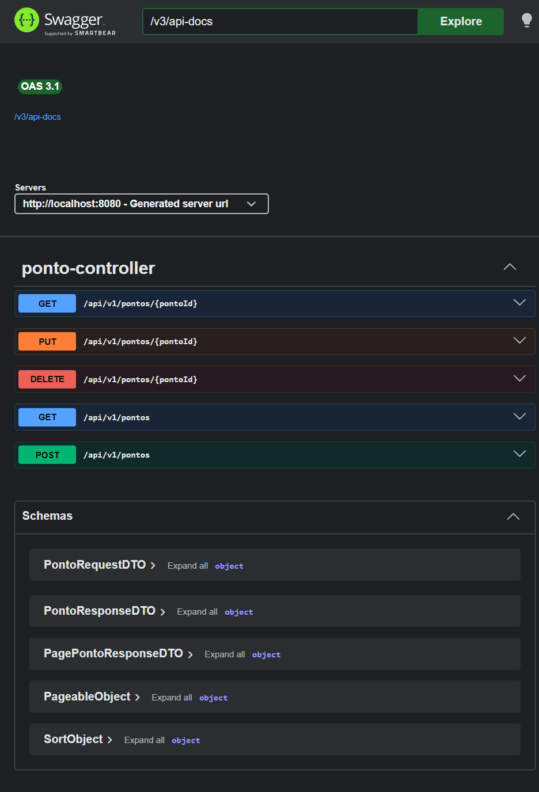

# ONG-Alimentos

O projeto é dividido em duas partes:

- **back-end-api**: API REST desenvolvida com Java e Spring Boot.
- **front-end**: aplicação web/mobile desenvolvida com Expo e React Native.

## Requisitos

- Java 21
- Maven Wrapper
- Node.js e npm, para executar o front-end

## Executando o back-end

Abra um terminal na pasta do projeto e execute:

```bash
cd back-end-api
.\mvnw spring-boot:run
```

A API fica disponível em:

```text
http://localhost:8080
```

O banco H2 é persistido em arquivo em `back-end-api/data/db-api.mv.db`.

## Swagger

Documentação interativa:

- [Swagger UI](http://localhost:8080/swagger-ui/index.html)
- [OpenAPI JSON](http://localhost:8080/v3/api-docs)



## Endpoints

Todos os endpoints usam o prefixo `/api/v1/pontos`.

| Método | URL | Resposta esperada |
|---|---|---|
| GET | `/api/v1/pontos?page=0&size=20&sort=id` | `200 OK` com a página de pontos |
| GET | `/api/v1/pontos/{id}` | `200 OK` com um ponto |
| POST | `/api/v1/pontos` | `200 OK` com o ponto criado |
| PUT | `/api/v1/pontos/{id}` | `200 OK` com o ponto atualizado |
| DELETE | `/api/v1/pontos/{id}` | `200 OK` |

### Exemplo de requisição

```json
{
  "nome": "Ponto de Doação Centro",
  "endereco": "Rua A, 123 - Goiânia/GO",
  "diasQueAtende": ["SEGUNDA", "QUARTA"],
  "tiposDoacao": ["ALIMENTOS", "ROUPAS"],
  "latitude": -16.6869,
  "longitude": -49.2648
}
```

### Respostas documentadas

#### GET /api/v1/pontos

```json
{
  "content": [
    {
      "id": "01e0baad-d52a-4659-abc4-39f506e922dd",
      "nome": "Posto de Coleta Norte",
      "endereco": "Rua Nova, 999",
      "diasQueAtende": ["SABADO"],
      "tiposDoacao": ["ROUPAS", "HIGIENE"],
      "latitude": -16.6500,
      "longitude": -49.2564
    }
  ],
  "totalElements": 8,
  "totalPages": 1
}
```

#### GET /api/v1/pontos/{id}

Retorna `200 OK` e um objeto `PontoResponseDTO`.

#### POST e PUT /api/v1/pontos

Retornam `200 OK` e o objeto `PontoResponseDTO` persistido.

#### DELETE /api/v1/pontos/{id}

Retorna `200 OK` sem corpo.

#### Erro de validação — 400 Bad Request

Ocorre quando `nome` ou `endereco` estão vazios, ou quando uma lista obrigatória está vazia:

```json
{
  "status": 400,
  "error": "Bad Request"
}
```

#### Ponto inexistente — 404 Not Found

Ocorre no GET ou PUT de um UUID que não existe:

```json
{
  "status": 404,
  "error": "Not Found",
  "message": "Ponto não encontrado"
}
```

## Tecnologias e organização

- Spring Web MVC
- Spring Data JPA
- H2 em arquivo
- Lombok
- Bean Validation
- springdoc OpenAPI / Swagger
- Pacotes `entity`, `repository`, `service`, `controller` e `dto`

O CORS está liberado para permitir o consumo da API pelo front-end.

## Executando o front-end

Em outro terminal:

```bash
cd front-end
npm install
npm start
```

Depois, escolha uma das opções exibidas pelo Expo:

- `w`: executar no navegador
- `a`: executar no Android
- escanear o QR Code pelo aplicativo Expo Go

Também é possível executar diretamente no navegador:

```bash
npm run web
```

Ou no Android:

```bash
npm run android
```

O front-end está configurado para acessar a API em:

```text
http://localhost:8080
```

Por isso, o back-end deve estar em execução antes de utilizar as funcionalidades que dependem da API.